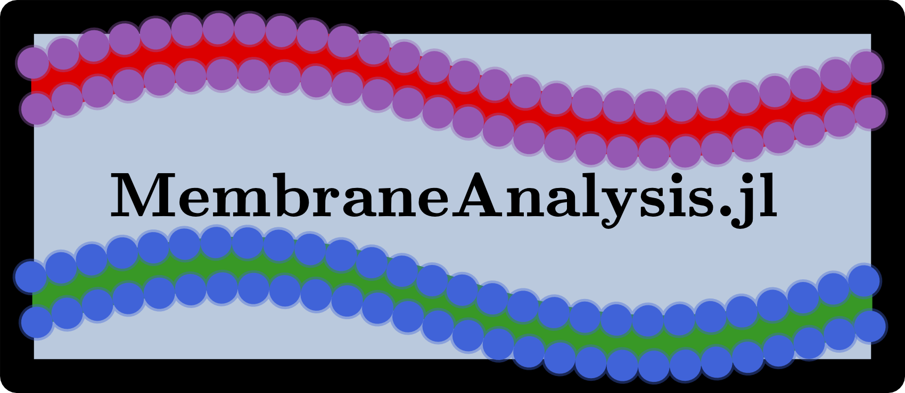

<p align="center">

</p>

# MembraneAnalysis.jl

A Julia package for analysing molecular dynamics simulations of lipid membranes.

[](https://github.com/amiralih/MembraneAnalysis.jl/actions/workflows/CI.yml)
[](https://amiralih.github.io/MembraneAnalysis.jl/dev)
[](https://doi.org/10.21105/joss.05380)

`MembraneAnalysis.jl` computes height and thickness fluctuation spectra of flat bilayers and
uses them to determine bending and area expansion moduli, curvature and thickness spectra of
lipids and embedded proteins (optionally along x or y only), transverse curvature bias,
spontaneous-curvature differences and the neutral surface. Around proteins the membrane surface
can be reconstructed by minimising its bending energy.

## Installation

```julia
pkg> add MembraneAnalysis
```

## Usage

Describe the system and the analyses in a parameters file (see
[`examples/parameters.toml`](examples/parameters.toml)):

```toml
[[lipids]]
name = "POPC"
head_atom = "NC3"
ref_atom = "C1A"
tail_atom = "C4B"
n_atoms = 12

[[proteins]]
name = "PEP"

[surface]
grid_spacing = 15.0
mask_radius = 5.0          # reconstruct the surface within 5 Å of the peptide backbone

[[analysis]]
type = "box"

[[analysis]]
type = "lipid_curvature_spectrum"

[[analysis]]
type = "protein_curvature_spectrum"
residue = 16
direction = "x"
```

and run it on all trajectories at once:

```bash
membrane-analysis parameters.toml step5_charmm2gmx.pdb step7_{1..15}.xtc -o results
# or, with any Julia version:
julia --project=path/to/MembraneAnalysis.jl path/to/MembraneAnalysis.jl/bin/membrane-analysis.jl \
      parameters.toml step5_charmm2gmx.pdb step7_{1..15}.xtc -o results
```

Trajectories are processed in parallel on all available CPUs (one frame in memory per process),
per-frame results of every trajectory are saved to HDF5, and means with block-averaged standard
errors are written to text files. From Julia:

```julia
using MembraneAnalysis
run_analysis("parameters.toml", "step5_charmm2gmx.pdb", ["step7_$(i).xtc" for i in 1:15];
             output_dir="results")
```

See the [documentation](https://amiralih.github.io/MembraneAnalysis.jl/dev) for all analyses,
the parameters reference, the methods, and the
[migration guide](https://amiralih.github.io/MembraneAnalysis.jl/dev/migration/) from v0.3.

## Citation

If you use this package, please cite
[Hossein & Sodt, *J. Open Source Softw.* 8, 5380 (2023)](https://doi.org/10.21105/joss.05380)
(see [`CITATION.cff`](CITATION.cff)).

## Contribution

User feedback is appreciated. Please create a
[GitHub Issue](https://github.com/amiralih/MembraneAnalysis.jl/issues) to report bugs or
suggest new features, or a [Pull Request](https://github.com/amiralih/MembraneAnalysis.jl/pulls)
to contribute to the package.
