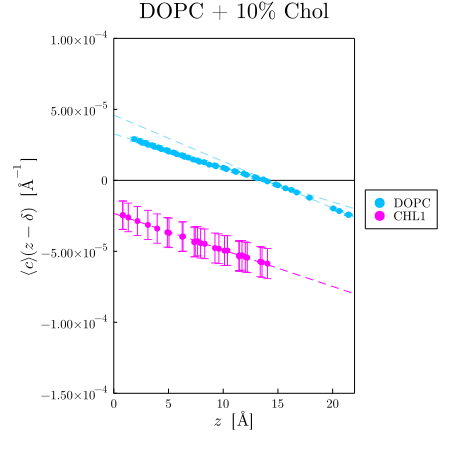

# Example usage of `MembraneAnalysis.jl`

In this tutorial we analyse atomistic simulations of a membrane of DOPC with 10 mol%
cholesterol. The input files (a PDB structure `s.pdb` and trajectories `t1.dcd` … `t10.dcd`)
can be downloaded [here](https://doi.org/10.5281/zenodo.8007968). Unzip the archive and run
the commands below inside the extracted folder.

## Parameters file

Create a file `parameters.toml`:

```toml
title = "DOPC + 10 % cholesterol (CHARMM36)"

[[lipids]]
preset = "DOPC_aa"          # Lipid("DOPC", "N", "C24", "C318", 138)

[[lipids]]
preset = "Chol_aa"          # Lipid("CHL1", "C3", "C11", "C27", 74)

[surface]
grid_spacing = 15.0         # Å

[statistics]
blocking = "trajectory"     # each of the 10 trajectories is one block

[output]
directory = "results"

[[analysis]]
type = "box"                # area and area expansion modulus

[[analysis]]
type = "undulation"         # bending modulus from the height fluctuation spectrum
q_max = 0.08

[[analysis]]
type = "tcb"                # transverse curvature bias analysis
q_max = 0.08
z_cutoff = 14.0
weights = { DOPC = 0.9, CHL1 = 0.1 }
```

## Running the analysis

```bash
membrane-analysis parameters.toml s.pdb t{1..10}.dcd
```

or, from Julia,

```julia
using MembraneAnalysis
run_analysis("parameters.toml", "s.pdb", ["t$(i).dcd" for i in 1:10])
```

The ten trajectories are processed in parallel. When the run is finished, `results/` contains
(among others):

- `KA.dat` — the area expansion modulus, ≈ 0.7 k_BT/Ų;
- `TCB.dat` — the bending modulus from transverse curvature bias, ≈ 20 k_BT, and the neutral
  surface;
- `TCB_lipids.dat` — the curvature bias of DOPC and cholesterol relative to the weighted
  average;
- `DOPC_TCB_profile.dat`, `CHL1_TCB_profile.dat` — mean height and sampled curvature of every
  carbon atom, from which the TCB curves below can be plotted (see the documentation);
- `kc_hq2.dat` — the bending modulus from the undulation spectrum;
- `summary.toml` — all scalar results with their errors.

<p align="center">

</p>

The neutral-surface atom of each lipid (the reference atom for curvature and thickness spectra)
can be read off the profile files: it is the atom whose mean height is closest to the neutral
surface reported in `TCB.dat`.

## References
<a id="1">[1]</a>
Sapp, K. C., Beaven, A. H., and Sodt, A. J. (2021).
Spatial extent of a single lipid's influence on bilayer mechanics.
Phys. Rev. E 103, 042413.
